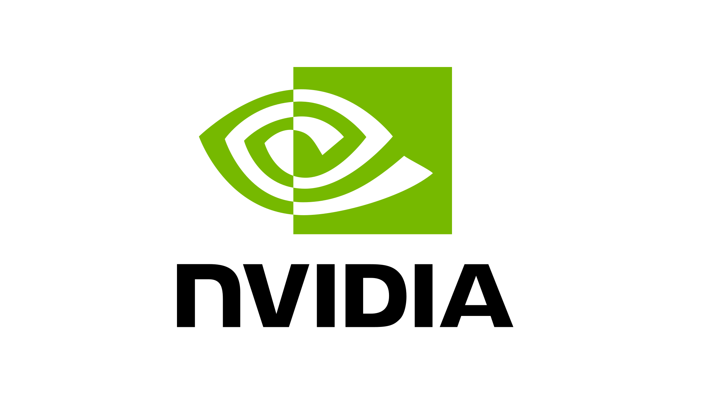

# MemSeg-Agent

We present **MemSeg-Agent**, a memory-augmented framework that
shifts medical-image segmentation adaptation from backbone weights to memory
space. See [our paper](https://arxiv.org/abs/2603.05873).

**[Project page](https://b0wenchen.github.io/MemSeg-Agent/)** ·
[Paper](https://arxiv.org/abs/2603.05873) ·
[Code](https://github.com/b0wenchen/MemSeg-Agent)

> Research code only; not a clinical device or clinical decision-support tool.

## Modules

| Module | Location | Updated parameters/state |
| --- | --- | --- |
| Supervised static memory | `scripts/train_static.py` | Direct memory tokens or pseudo-image/mask logits; SAM2 is frozen |
| Few-shot memory | `scripts/eval_working_memory.py --support-root` | Non-parametric tokens from separate labeled support pairs |
| Test-time working memory | `scripts/eval_working_memory.py` | Bounded DINOv3 retrieval buffer with gated EMA updates |
| Agentic composition | `scripts/eval_working_memory.py --prototype-root` | Explicit prototype-similarity routing policy |
| Federated static memory | `scripts/train_federated.py` | Local training and FedAvg of pseudo-observation tensors |

Raw datasets, annotations, checkpoints, experiment outputs, local paths, and
vendored SAM2/MONAI/DINO code are intentionally excluded. Install external
dependencies and use all datasets under their respective licenses.

## Installation

```bash
git clone https://github.com/b0wenchen/MemSeg-Agent.git
cd MemSeg-Agent
# First install the PyTorch build matching your CUDA runtime.
pip install -r requirements.txt
```

Download a SAM2 checkpoint from the
[official SAM2 repository](https://github.com/facebookresearch/sam2), then
copy `configs/default.yaml` and set `sam2_checkpoint` to your local weight file.
Keep `sam2_config` as the SAM2 package config name (for example,
`configs/sam2.1/sam2.1_hiera_t.yaml`). The optional DINOv3 retrieval model is downloaded from Hugging
Face and may require access approval.

Before a reproducibility run, record the actual dependencies and weight hash:

```bash
python scripts/record_environment.py --output outputs/environment.json --checkpoint /path/to/sam2.1_hiera_tiny.pt
```

Check `sam2_import` in that file: another checkout (for example MedSAM2) on
`PYTHONPATH` can shadow the intended SAM2 installation. This snapshot records
the local environment; it is not a validated clean-install lockfile.

## Data Description

We evaluate static-memory segmentation on ACDC, CAMUS, and CHAOS, and use
CardiacUDA as an external benchmark for cross-domain evaluation. The counts
below describe the subsets used in our experiments, not necessarily the full
datasets available from their providers.

| Dataset and source | Modality and subset used | Patients | Images / sequences used | Segmentation targets |
| --- | --- | ---: | --- | --- |
| [ACDC](https://www.creatis.insa-lyon.fr/Challenge/acdc/) | Short-axis cardiac cine MRI; annotated ED/ES phases from the training cohort | 100 | 200 3D volumes (two phases per patient) | Right ventricle (RV), myocardium (Myo), left ventricle (LV) |
| [CAMUS](https://www.creatis.insa-lyon.fr/Challenge/camus/) | 2D echocardiography; apical two- and four-chamber views at ED/ES | 500 | 2,000 annotated 2D frames (two views × two phases per patient) | LV, Myo, left atrium (LA) |
| [CHAOS](https://arxiv.org/abs/2001.06535) | Abdominal T2-SPIR MRI; labeled training subset | 20 | 20 3D volumes (one per patient) | Liver, right kidney (RK), left kidney (LK), spleen |
| [CardiacUDA](https://github.com/XiaoweiXu/CardiacUDA-dataset) | External echocardiography; selected annotated apical four-chamber sequences | 8 | 8 sequences containing 428 annotated frames | LV and LA, aligned to the CAMUS label space |

ED and ES denote end-diastole and end-systole. We use only the annotated ED/ES
frames from CAMUS, whereas our CardiacUDA subset contains annotated frames
throughout the selected sequences. We store each CAMUS frame as a singleton-depth
NIfTI volume and each CardiacUDA sequence as a stack with time along the last
axis. These storage units must not be counted as additional patients.

For cross-domain evaluation, we train static memory on CAMUS and evaluate on
the selected CardiacUDA subset. We evaluate LV and LA only; we do not treat
unavailable CardiacUDA myocardium annotations as negative myocardium examples.
When evaluating working memory, we use corrections after scoring each prediction,
as described in the test-time evaluation section below.

### Labels and preprocessing

We train one binary segmentation task at a time using `target_class`. Background
is `0`; the preprocessed label conventions are:

| Dataset | Foreground label IDs | `num_classes` |
| --- | --- | ---: |
| ACDC | `1`: RV, `2`: Myo, `3`: LV | 4 |
| CAMUS | `1`: LV, `2`: Myo, `3`: LA | 4 |
| CHAOS | `1`: liver, `2`: RK, `3`: LK, `4`: spleen | 5 |
| CardiacUDA (our remapped subset) | `1`: LV, `3`: LA; other structures mapped to background | 4 |

Our experiments use preprocessed 256 × 256 slices/frames with upper-intensity
clipping at the 99.5th percentile. The loader performs per-volume min–max
normalization and repeats the grayscale image across three channels; the model
then resizes inputs to 1024 × 1024 for SAM2. We perform training and inference
slice by slice and aggregate predictions for volume/sequence-level evaluation.

We provide dataset-specific preprocessing through `scripts/preprocess_data.py`.
Our ACDC/CAMUS/CardiacUDA preprocessing includes annotation-centered crops
(a shared crop across frames for CardiacUDA); CHAOS uses image-center crops, so the
preprocessing protocol must be preserved when comparing results. The paper
describes 0.5 × 0.5 mm in-plane resampling, but the archived ACDC script defaults
to 1.25 × 1.25 × 7.70 mm and the CardiacUDA export uses pixel resizing with unit
spacing. We have not yet reconciled these settings against every reported run;
the current loader does not enforce physical-spacing resampling. Our archived
CHAOS preprocessing also defaults to 1.25 × 1.25 × 7.70 mm. We preserve these
defaults and expose `--spacing` rather than silently changing the protocol.

```bash
pip install -e '.[preprocessing]'
python scripts/preprocess_data.py --dataset acdc --root /path/to/ACDC/training --output data/acdc
python scripts/preprocess_data.py --dataset camus --root /path/to/CAMUS/database_nifti --output data/camus
# Install dcm2niix separately for raw CHAOS DICOM + PNG conversion.
python scripts/preprocess_data.py --dataset chaos --raw-chaos --root /path/to/CHAOS/MR --output data/chaos
# Or omit --raw-chaos and provide paired converted image_<id>/label_<id> NIfTI files.
python scripts/preprocess_data.py --dataset cardiacuda --root /path/to/label_all_frame --output data/cardiacuda
```

We refuse to overwrite existing preprocessing output directories and save the
effective settings in `preprocessing.json`. For CHAOS, verify DICOM/PNG alignment
visually after conversion. The MRI dataset contains 40 subjects overall; our
20-subject count refers to its labeled training subset, not the full MRI dataset.

### Input format and patient-level splits

We use paired volumes and a patient-identity mapping:

```text
dataset/
├── image_1.nii.gz
├── label_1.nii.gz
├── ...
└── index_mapping.csv  # columns: new_index, patient_id
```

We keep every patient's phases, views, and slices in the same split. For the
in-domain datasets, our supplied splitter uses a patient-level 3:1:1
train/validation/test protocol: an outer five-fold partition selects the test
fold, then one quarter of the remaining patients form the validation set.
This gives 60/20/20 patients for ACDC, 300/100/100 for CAMUS, and 12/4/4 for
CHAOS per fold. These are our experimental splits, not the providers' official
challenge splits. Our external CardiacUDA benchmark uses all eight selected
patients for testing rather than applying this in-domain split. We use
`configs/cardiacuda_external.yaml` to evaluate all eight sequences without any
training/validation partition. Its `mapping_id_column: base` accepts our original
CardiacUDA CSV; these eight selected sequences identify eight distinct patients.

For ACDC and CAMUS, provide a complete `index_mapping.csv` with `new_index`
and `patient_id`, so phases and views remain grouped. For CHAOS, each file ID
already identifies a single patient; the loader can use this ID when no mapping
is present. We do not redistribute images or annotations. Obtain them from
the linked dataset providers and follow their access and citation requirements.

## Static-memory training

### Choosing a static-memory parameterization

We study two static-memory parameterizations in our ablations:

| Intended use | Optimization target | Memory representation |
| --- | --- | --- |
| Static-only segmentation | Directly train memory tokens (and their positional parameters) | Compact memory (our “2M” memory size) |
| Static memory followed by test-time working-memory aggregation | Train pseudo-image and pseudo-mask logits through the frozen encoder | Encoder-generated static memory, composed with encoded corrected observations |

Our ablation results show that the two approaches achieve similar static
segmentation performance. For static-only training, we directly optimize the
compact memory. For subsequent test-time working-memory aggregation, we train
pseudo-image and pseudo-mask logits through the frozen encoder.

Here, “2M” denotes our compact memory size; it
does not denote the number of trainable pseudo-image and pseudo-mask logits.
Storage in bytes depends on tensor shapes, dtype, and whether positional
encodings are included, and should be reported separately from parameter count.

We provide both routes through `MemSegAgent` and `scripts/train_static.py`.
They share memory attention, decoding, loss, and the training loop. Direct-token
training initializes and optimizes `learnable_memory` and `learnable_memory_pos`;
pseudo-observation training initializes logits and encodes them at each forward
pass. Select the route with `memory_mode` in YAML or `--memory-mode` on the CLI.

```bash
cp configs/default.yaml configs/acdc_lv.yaml
# Edit paths, target_class, num_classes, and output_dir.
python scripts/train_static.py --config configs/acdc_lv.yaml --fold 0 --memory-mode pseudo_observation
# Static-only direct-token ablation:
python scripts/train_static.py --config configs/acdc_lv.yaml --fold 0 --memory-mode direct_tokens
```

We save checkpoints under `<output_dir>/<memory_mode>/fold_<N>/` so the two
experiments remain separate. Each checkpoint stores the selected memory
parameters and configuration, with no SAM2 backbone weights.

Evaluate a direct-token checkpoint without DINO or test-time feedback:

```bash
python scripts/eval_working_memory.py --config configs/acdc_lv.yaml --fold 0 \
  --static-only \
  --static-checkpoint outputs/static_memory/direct_tokens/fold_1/best_static_memory.pt
```

We also support `--static-only` with pseudo-observation checkpoints for comparison.

### Fixed splits and reduced-label experiments

```bash
python scripts/make_splits.py --data-root /path/to/preprocessed_dataset --output splits/camus
python scripts/run_experiments.py --config configs/camus_lv.yaml --split-dir splits/camus --fractions 1.0 0.1 0.3
```

Copy `configs/default.yaml` to create `configs/camus_lv.yaml` and set local paths
first. Fractions select patients **within the training partition**, rounded up;
validation and test patients do not change. This denominator is explicit and
must be matched to the reported experiment before comparing results. Each
checkpoint records patient IDs, and each training directory contains `split.json`.
Pass that file to evaluation with `--split-manifest` to reuse the exact split.

### Explicit inference profiles

We use our final `cross_test.py` implementation as the reference for cross-domain
inference. External evaluation selects `cross_domain` by default, for both
static-only and static-plus-working-memory runs. Static training is unchanged:

| `--eval-profile` | Static pseudo-mask input to memory encoder | Decoder at evaluation |
| --- | --- | --- |
| `training` (in-domain default) | `sigmoid(logits)` | Soft objectness mixing and IoU-weighted masks, as in `img_supmem_5F.py` |
| `cross_domain` (external default) | `sigmoid(logits)` **without scaling** | Hard objectness gate and highest-IoU mask, as in `cross_test.py` |

We do not apply `20 * mask - 10` to the learned static pseudo-mask. We still
apply that scaling to corrected observation masks when encoding working memory,
matching `cross_test.py`. The older scaled-static `adaptive_legacy` profile has
been removed to avoid mixing protocols; replace it with `cross_domain` in older
configs. We record the selected profile in evaluation JSON. This alignment covers
mask encoding and decoding, not equivalence of the complete online trajectory:
buffer capacity, retrieval count and update-gate settings must also match a run.
With an original CAMUS pseudo-observation checkpoint, our four-frame regression
probe matches `cross_test.py` exactly for static tokens, corrected-observation
tokens, static-only logits, and logits with the same working-memory entry.

We retain both direct-token and pseudo-observation static training. Some static
experiments were run on a separate server; local direct-token logs alone do not
identify the parameterization of all our final static results. Our cross-domain
workflow uses pseudo-observation checkpoints.

## Test-time working memory

```bash
python scripts/eval_working_memory.py \
  --config configs/acdc_lv.yaml \
  --fold 0 \
  --static-checkpoint outputs/static_memory/pseudo_observation/fold_1/best_static_memory.pt \
  --feedback-dice-threshold 0.5 \
  --save-working-memory outputs/working_memory/fold_1.pt
```

This evaluation is an **oracle-feedback simulation**: a ground-truth slice is
used only when its prediction Dice is below the threshold, as a stand-in for a
clinician correction. In deployment, replace this with an audited human
feedback workflow; model predictions are never written as corrections.

We score each prediction **before** adding its correction, retain the buffer
across the ordered test stream, and report per-volume/sequence Dice in JSON
(`--output`). If prediction and ground truth are both empty, Dice is **1**.

### External cross-domain test: CardiacUDA

```bash
# Set local paths in configs/cardiacuda_external.yaml. Use a CAMUS-trained checkpoint.
python scripts/eval_working_memory.py --config configs/cardiacuda_external.yaml \
  --static-checkpoint /path/to/camus_best_static_memory.pt --static-only \
  --output outputs/cardiacuda_static.json
```

We check that all eight sequences are present. CardiacUDA is never used for
gradient training, validation, or checkpoint selection; training scripts reject
external-set configs. Omit `--static-only` only for the separately reported
oracle-feedback working-memory experiment. This uses test-time corrections
after scoring, not supervised training on the external dataset.

### Few-shot and controller composition

```bash
python scripts/eval_working_memory.py --config configs/camus_lv.yaml \
  --static-checkpoint /path/to/best_static_memory.pt \
  --support-root /path/to/separate_labeled_supports --support-slices 1 \
  --prototype-root /path/to/training_domain_prototypes \
  --output outputs/composition.json
```

Support and prototype directories use the same paired NIfTI/CSV format and must
not contain test patients. Use stable, dataset-qualified IDs across directories.
We select the first requested foreground-containing support slices in file order
and record their identities. The prototype is the normalized mean DINO embedding
of up to 16 supplied training-domain slices. Our explicit controller retains
static memory, adds few-shot memory below the similarity threshold, and adds
retrieved working memory when available. Without `--prototype-root`, supports
are always composed. `--static-only` disables feedback but still permits the
explicit support set. This is a transparent policy implementation, not a claim
that a learned agent or a particular published support selection is reproduced.

## Federated memory-only aggregation

```bash
python scripts/train_federated.py --config configs/camus_lv.yaml --fold 0 \
  --sites 4 --rounds 10 --local-epochs 1
```

We provide a sequential single-process FedAvg simulation. Sites partition only
training patients; by default the partition is seeded and random. To reproduce
specific site assignments, supply `--site-manifest` with a JSON list of patient-ID
lists. Local AdamW is reset each round, aggregation is weighted by training-slice
count, and checkpoint selection uses validation patients only. This is not a
distributed NVFlare deployment or a reconstruction of undocumented site splits.

For already-trained client checkpoints, we also provide:

```bash
python scripts/fedavg_memories.py \
  --inputs client_a.pt client_b.pt client_c.pt client_d.pt \
  --weights 120 95 110 102 \
  --output global_static_memory.pt
```

The helper aggregates only pseudo-observation tensors; no raw data, SAM2
parameters, DINO features, or working-memory entries are communicated.
Its communication payload therefore follows the pseudo-observation tensors,
not the compact “2M” memory size discussed for static-only direct-token training.

## Verification

Our GitHub Pages project website lives in `docs/`. It uses plain HTML/CSS/JS,
without a build step. Edits to `docs/` on `main` automatically deploy through
`.github/workflows/pages.yml`. Figures are from our published paper; displayed
metrics are reported paper results, not results from a live inference service.

```bash
python -m pytest -q
python -m compileall -q src scripts
```

## Citation

```bibtex
@article{chen2026memsegagent,
  title={Shifting Adaptation from Weight Space to Memory Space: A Memory-Augmented Agent for Medical Image Segmentation},
  author={Chen, Bowen and Gao, Qiaohui and Wan, Shaowen and others},
  journal={arXiv preprint arXiv:2603.05873},
  year={2026}
}
```

Please also cite and comply with the licenses of SAM2, DINOv3, and the data
sources used in an experiment.

## Acknowledgements

<a href="https://www.nvidia.com/"></a>

We gratefully acknowledge NVIDIA for supporting our research on MemSeg-Agent.
