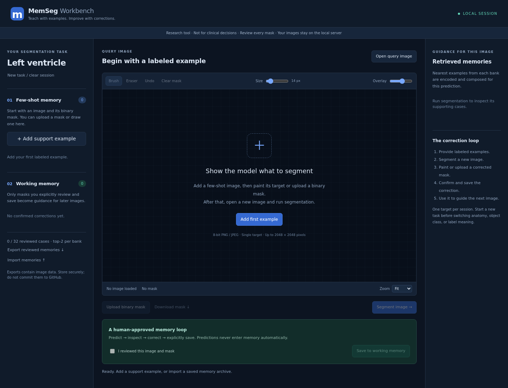

# MemSeg Workbench

**Teach with examples. Improve with corrections.**

We provide a local browser workbench and an embeddable Python API for our
few-shot and working-memory segmentation workflow. SAM2 segments a query using
labeled examples retrieved with DINOv3. When you correct and explicitly save a
mask, we encode that image/mask pair into working memory for subsequent queries.
Both models stay frozen. No static memory is allocated, trained, or loaded.



## Install and launch

Use Python 3.10+ on Linux; a CUDA GPU is recommended. Install a matching PyTorch
and torchvision build first, following the
[SAM2 installation guide](https://github.com/facebookresearch/sam2/blob/main/INSTALL.md).
SAM2 currently requires PyTorch 2.5.1+ and torchvision 0.20.1+.

```bash
git clone https://github.com/b0wenchen/MemSeg-Agent.git
cd MemSeg-Agent
python -m pip install -e '.[workbench]'
python -m pip install 'git+https://github.com/facebookresearch/sam2.git'
```

Download `sam2.1_hiera_tiny.pt` from the
[official SAM2 checkpoint links](https://github.com/facebookresearch/sam2#download-checkpoints).
Our default retrieval model is
[`facebook/dinov3-vitb16-pretrain-lvd1689m`](https://huggingface.co/facebook/dinov3-vitb16-pretrain-lvd1689m).
Accept its access terms and authenticate with Hugging Face if required. The
workbench extra requires Transformers 4.56+ for
[DINOv3 support](https://huggingface.co/docs/transformers/v4.56.0/en/model_doc/dinov3).
Model weights are downloaded on first use; input images are not sent to these
providers. Model licenses and access requirements apply separately from our code.

```bash
memseg-workbench \
  --sam2-checkpoint /path/to/sam2.1_hiera_tiny.pt \
  --target "Left ventricle" \
  --device cuda
```

Open **http://127.0.0.1:8765** after the terminal reports that the models are ready.
The module form works too: `python -m memseg_agent.interactive.server` with the
same arguments. `--device auto` is the default; `--device cpu` is supported but
can be slow. Other options are `--port`, `--top-k` (1–4 per bank, default 2),
`--dino-model` (a compatible Hugging Face ID or local model directory), and
`--sam2-config` (must match the checkpoint).

For a GPU server, keep the service bound to loopback and forward its port:

```bash
ssh -N -L 8765:127.0.0.1:8765 your-user@your-gpu-server
```

Then open the same loopback URL on your own computer. This is a single-user
application, not a public hosted service. Use one browser tab per server process;
tabs connected to the same process share its memory banks. Independent users or
tasks need separate processes and ports. The existing GitHub Pages site hosts
the project description, not this model service.

## Use the correction loop

1. **Provide a few-shot example.** Choose **Add support example**, open an image,
   and upload its binary PNG mask or paint it with the brush. Inspect the overlay,
   check **I reviewed this image and mask**, and add it to few-shot memory.
2. **Segment a query.** Choose **Open query image**, then **Segment image**. We
   retrieve the nearest examples from each bank and compose their encoded memory
   tokens. The right panel shows which examples supported this prediction.
3. **Correct and remember.** Use the brush, eraser, undo, or a replacement mask.
   Review the result and select **Save to working memory**. This explicit action
   saves the query image and the corrected mask; it does not update model weights.
4. **Continue.** Open another query. Its prediction can now use both the original
   examples and the confirmed corrections. You can inspect or delete any stored
   case and download the current binary mask.

Changing the mask clears its confirmation checkbox. A model prediction is never
saved automatically. You may also draw a query mask entirely by hand, or confirm
an accurate prediction after inspection. A reviewed all-background query mask is
allowed; initial few-shot examples must contain foreground.

## Inputs and memory behavior

| Setting | Current behavior |
| --- | --- |
| Images | 2D 8-bit PNG/JPEG; grayscale or RGB; at most 4,194,304 pixels and 20 MiB per upload |
| Masks | Opaque grayscale binary PNG, values 0/1 or 0/255, exactly matching the image dimensions |
| Task | One binary target per session; start a new session when its meaning changes |
| Editing | Brush/eraser, 10 undo steps, overlay opacity, fit/100%/200%/400% zoom |
| Capacity | 32 reviewed cases total across both banks; full banks require explicit deletion |
| Retrieval | DINOv3 cosine similarity; up to `top_k` examples **from each bank** |
| Memory write | Encode each reviewed image/mask with frozen SAM2; preserve exact individual cases |
| Repeated image | Re-saving the same decoded image in the same bank updates its mask; cross-bank duplicates are rejected |
| Output | Binary PNG at the original input dimensions; no voxel spacing or image metadata |
| Persistence | Explicit ZIP export/import of reviewed examples; no automatic disk writes |

We resize inputs internally using the repository's SAM2 image path and use its
`cross_domain` decoder profile. Observation masks follow `encode_observation`'s
existing scaling convention. We do not apply dataset-specific crops, intensity
normalization, or physical-spacing resampling here. Normalize high-bit-depth data
explicitly and use consistent orientation and preprocessing for examples and
queries. This release does not directly load DICOM, NIfTI, 3D volumes, videos, or
multi-class masks; select one target and export aligned 2D image/mask pairs first.
JPEG EXIF orientation is not applied; export physically oriented pixels when
orientation metadata is present.

Our interactive bank deliberately retains individual reviewed examples for
inspection and removal. It does **not** perform the experimental Dice-dependent
EMA merging used by `scripts/eval_working_memory.py`, and it has no oracle
ground-truth gate. This is an interactive adaptation of our memory idea, not a
claim to reproduce the complete paper evaluation protocol. Corrections provide
additional guidance; they do not guarantee better segmentation on every query.

## Python API

The session API is independent of FastAPI and the browser, so another application
can supply its own image loader and annotation tools. Arrays must be `uint8`
H×W grayscale or H×W×3 RGB images and H×W binary masks. A minimal loop:

```python
from pathlib import Path
import numpy as np
from PIL import Image
import torch

from memseg_agent.model import MemSegAgent
from memseg_agent.working_memory import DINOv3Embedder
from memseg_agent.interactive import SegmentationSession

device = torch.device("cuda" if torch.cuda.is_available() else "cpu")
model = MemSegAgent(
    "configs/sam2.1/sam2.1_hiera_t.yaml",
    "/path/to/sam2.1_hiera_tiny.pt",
    memory_mode="none",
    eval_profile="cross_domain",
).to(device).eval()
embedder = DINOv3Embedder("facebook/dinov3-vitb16-pretrain-lvd1689m", device)
session = SegmentationSession(model, embedder, target="Left ventricle", top_k=2)

support_image = np.array(Image.open("support.png").convert("RGB"))
support_mask = np.array(Image.open("support_mask.png").convert("L"))
session.add_support(support_image, support_mask, name="Support 1")

query = np.array(Image.open("query.png").convert("RGB"))
query_id = session.set_query(query, name="Query 1")
prediction, retrieved = session.predict(query_id)
Image.fromarray(prediction.astype(np.uint8) * 255).save("prediction.png")

# Obtain this mask from your annotation UI after a human review/correction.
corrected = np.array(Image.open("human_reviewed_mask.png").convert("L"))
session.confirm_correction(query_id, corrected, confirmed=True)

# This later query can retrieve the newly confirmed working-memory case.
next_query = np.array(Image.open("next_query.png").convert("RGB"))
next_id = session.set_query(next_query, name="Query 2")
next_prediction, retrieved = session.predict(next_id)

# Optional local persistence. This archive contains actual images and masks.
Path("memseg-reviewed-memories.zip").write_bytes(session.export_archive())
restored = SegmentationSession(model, embedder)
restored.import_archive(Path("memseg-reviewed-memories.zip").read_bytes())
```

`summary()` returns case metadata. `remove(memory_id)` deletes one case, and
`reset(target="New target")` clears both banks and the current query. Query IDs
prevent a delayed correction from being applied to a different image. Inference
and bank mutations are serialized per session. Models can be shared by sessions
in a host application, but that host must coordinate concurrent model access.

## Local data and persistence

We keep cases in the Python process's memory. Closing a tab does not clear them;
stopping the process does. Unsaved canvas edits live only in that tab. Export
reviewed memories before stopping if you want to resume later. Import into a new
empty session: we reconstruct both banks and re-encode the examples with the
currently loaded models. Unsaved edits, predictions, and the current query are
not included. The archive contains PNG pairs and a JSON manifest, not executable
pickle/checkpoint files. Imports are atomic and bounded to 192 MiB of ZIP content
and decompressed members; oversized exports fail with a clear error.

Archives and downloaded masks are **not encrypted** and contain image data.
Store them appropriately, and keep patient images and memory archives out of
GitHub. Our browser assets are bundled locally and use no external CDNs. After
the model files are cached, `HF_HUB_OFFLINE=1` supports offline startup. When using
SSH forwarding, images go to your selected GPU server over that connection.

## Validation and scope

We validated the upload → prediction → manual correction → memory retrieval loop
with real SAM2.1 Hiera Tiny and DINOv3 on a local CUDA GPU. Browser checks covered
brush editing/undo, explicit confirmation, mask download, memory inspection and
deletion, archive round-trips, and narrow-screen layout. These are functional
checks, not a clinical validation or a segmentation-quality benchmark.

For lightweight automated checks without model weights:

```bash
python -m pip install -e '.[workbench,dev]'
python -m pytest tests/test_interactive.py -q
```

Those tests use small model doubles to exercise the session and HTTP workflow;
they do not verify pretrained model accuracy. For an installation issue, check
the SAM2 import location, checkpoint/config pairing, DINOv3 access, and available
GPU memory. Lower `--top-k` if attention exceeds GPU memory.

This is research software and requires review of each output. See the
[repository license](../../LICENSE), [our paper](https://arxiv.org/abs/2603.05873),
and the [main README](../../README.md) for the experimental framework and citations.
We thank NVIDIA for supporting this research.
